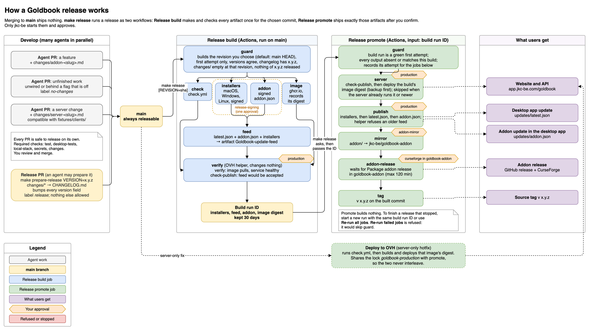

# Releasing Goldbook

A release is two manual runs on `main`. **Release build** tests one commit of
`main`, builds and signs everything, and checks OVH access without changing
anything. **Release promote** takes that build run's ID and ships exactly its
artifacts: the server first, then the update feed, then the addon mirror. It
then waits for goldbook-addon's own release and tags the commit.

Only `jkc-be` starts these workflows and approves their environments. The
normal way to start them is `make release`, described below.



The examples use illustrative PR and run numbers.

- [Several agent PRs become one release](release-flow/example-release.png)
- [Finishing a stopped promotion, and what the guards refuse](release-flow/example-stops.png)
- [Hotfixes](release-flow/example-hotfixes.png)

The diagrams are the four pages of `docs/release-flow.drawio`. After editing it
in draw.io, export each page again, numbered from 1:

```sh
drawio -x -f png -s 1.25 --theme light -b 10 -p 1 -o docs/release-flow/overview.png docs/release-flow.drawio
```

## Release outputs

A release has six outputs. `scripts/release-state.py` reads five of them and
accepts each one only when it belongs to the build run being promoted.

| Output | Read from | Belongs to the build run when |
| --- | --- | --- |
| Server deploy | Not read | It runs the image digest that the build run recorded in `Goldbook-server-image`. The OVH helper skips a deploy when the server already runs the revision or a later commit of `main`. |
| Client feed | `https://app.jkc-be.com/goldbook/updates/latest.json` | It is byte for byte the build run's `latest.json`. |
| Addon feed | `https://app.jkc-be.com/goldbook/updates/addon.json` | It is byte for byte the build run's `addon.json`. |
| Addon mirror | `jkc-be/goldbook-addon` HEAD | Its `upstream.json` names the revision. |
| Downstream addon release | Release `v<version>` in `jkc-be/goldbook-addon` | Its tag's commit has an `upstream.json` that names the revision. |
| Source tag | `v<version>` in `jkc-be/goldbook` | It points at the revision. |

Each output is reported as one of three states:

- `absent`: the output does not exist, or it holds an older release.
- `matches`: the output belongs to this build run.
- `conflict`: the output holds this version from another build, or a newer
  version. A conflict stops the run and needs a decision from you.

goldbook-addon is read through GitHub's public API without credentials,
because the workflow token reaches only its own repository. Unauthenticated
requests share a limit of 60 per hour per runner address. If a busy runner
address hits it, the job fails without changing anything and can be rerun.

## Release with make release

1. Merge the release PR that `make prepare-release VERSION=<version>`
   produced. The release PR carries the label `release`, not `no-changes`.
2. Note the release PR's merge commit, then run:

   ```sh
   make release REVISION=<merge commit>
   ```

   Without `REVISION`, the build takes the current `main`, which refuses to
   build once another PR has added a change file after the release PR.
3. The script dispatches **Release build** through `gh` as you, prints the run
   link and follows the run. Approve `release-signing`, then `production`, in
   the browser.
4. When the build succeeds, the script prints the version, the revision and
   the artifacts, and asks `Promote build run N (version V, revision R)? [y/N]`.
5. Answer `y`. The script dispatches **Release promote** for that build run
   and follows it. Approve its environments as listed under
   [Promote](#promote).

`make release` stops at the first failure and says what to do next. It needs
`gh` signed in as `jkc-be`, and refuses any other account.

The script only starts and watches the two runs. They stay separate on
GitHub: the build never ships anything, and a promotion takes a build run ID.
When you answer no, or the promotion fails, promote the build later with the
command the script prints, which is also in the build run's summary:

```sh
gh workflow run release-promote.yml --ref main -f build_run_id=<build run ID>
```

The script finds each run it started by a random request identifier. It
passes the identifier as the `request` input, both workflows put it in their
run name as `[<identifier>]`, and the script takes only the run with that
name, so a run another agent starts at the same moment is never mistaken for
yours.

Before it asks to promote, the script checks that the build built the commit
you asked for: the full SHA of `REVISION`, or without `REVISION` the commit the
build run started on. A build of any other commit stops the script.

## Build

Use `make release`, or open **Actions > Release build > Run workflow** on
`main` and enter the revision.

1. Approve `release-signing` once for the three installer jobs and the addon
   signing job, which wait together.
2. Approve `production` for the `verify` job.
3. Note the run ID. The `verify` summary lists the revision, the version, the
   server image digest, the ID and digest of every artifact, and the command
   that promotes the build.

### Build a revision

The `revision` input names the commit to build, as a full or abbreviated SHA.
Leave it empty to build the commit `main` points at when the run starts.
Agents keep merging to `main` after the release PR. Building the release PR's
merge commit keeps their changes out of the release, without blocking them.

The `guard` job resolves the input to a full SHA and requires it to be the
commit the run started on or an earlier commit in `main`'s history. Every
later job builds that revision: the installers, the signed addon,
the server image, tagged `server:<revision>` and labelled
`org.opencontainers.image.revision=<revision>`, and the feed, whose package
URLs and `addon.json` name it. `Goldbook-server-image` records it in
`image.json`.

The checks are not run again. Every push to `main` starts **Check** for
exactly that commit, and the `check` job waits up to 30 minutes for that run
and requires it to pass. So the revision must be a commit that was pushed to
`main`, such as the release PR's merge commit, not a commit in the middle of a
merged branch. `check.yml` takes no ref input, so its jobs never run code
checked out from an input while holding `main`'s caches. The build jobs do
check out the input revision, but only after `guard` has confirmed it is in
`main`'s history, so they run nothing that was not already merged.

Promote reads the revision from `image.json`, not from the commit the build
run started on. It requires the build's `addon.json` to name the same
revision, and the commit the build run started on to contain it.

The `guard` job refuses to build when:

- the run is a rerun. Start a new Release build run instead.
- the revision is not a SHA, does not name exactly one commit, or is not in
  the history of `main`.
- `scripts/set-version.py --check` finds version fields that disagree.
- `CHANGELOG.md` has no `## <version> - ` section, or `changes/` still holds
  change files.
- any output of this version is not `absent`. When the version is partly
  released, the message names the build run to promote. When it is fully
  released or no build run can finish it, the message asks for a new version.

A build run proves:

- the **Check** run of the revision's push to `main` passed
- the installers build and are signed
- the addon update is signed
- the feed has the layout the OVH helper accepts
- the helper accepts this build run (`verify`), and its feed passes the
  helper's validation (`check-publish`)
- the image is pushed, its digest is recorded in `Goldbook-server-image`, and
  OVH can pull it
- the deployment is authorized

A build run does not start the candidate server or apply its migrations to
production data. The running service is checked, not replaced.

A failed build run is never rerun. Rerunning all jobs or only the failed jobs
fails at `guard` or `verify`, and promote refuses any run attempt after the
first. Start a new build run. Nothing was shipped, so nothing is lost.

A promotion depends on these artifacts of the build run:

| Artifact | Holds |
| --- | --- |
| `Goldbook-update-feed` | `latest.json`, `addon.json` and the signed updater packages under `<revision>/`, as the helper publishes them. |
| `Goldbook-addon-feed` | The signed `addon.json`. |
| `Goldbook-updater-macOS-ARM64`, `Goldbook-updater-Windows-X64`, `Goldbook-updater-Linux-X64` | The signed updater packages of each platform. |
| `Goldbook-server-image` | `image.json`, with the revision and the digest of the pushed image. The helper deploys exactly that digest, not the `server:<revision>` tag, which can be pushed again. |

Build artifacts are kept for 30 days, so a build run can be promoted for 30
days.

## Promote

1. Answer `y` in `make release`, or open **Actions > Release promote > Run
   workflow** on `main` and enter the build run ID.
2. Approve `production` for `server`. Its result line names the database
   backup, or says the deploy was skipped because the server already runs the
   revision or a later commit. Check `https://app.jkc-be.com/goldbook`.
3. Approve `production` for `publish`.
4. Approve `addon-mirror` for the mirror.
5. Approve `curseforge` in the **Package addon release** run in
   `jkc-be/goldbook-addon`.
6. The `tag` job creates `v<version>` on the built commit.

After **Package addon release** succeeds, the separate **Publish to
WoWInterface** workflow offers its `wowinterface` approval. It is secondary to
CurseForge: promotion and tagging never wait for its approval, upload or
moderation, and its failure does not fail the release. Inspect and retry that
workflow separately if needed.

The jobs, in order:

| Job | Does |
| --- | --- |
| `guard` | Requires a successful first attempt of `release-build.yml` on `main` by `jkc-be` with its feed, addon feed, three updater artifacts and server image artifact unexpired. Takes the revision from `image.json` and requires the build's `addon.json` to name it and the commit the build run started on to contain it. Checks out the revision, reads its version, downloads its `Goldbook-update-feed` and requires every output to be `absent` or `matches`. |
| `server` | Runs the helper's `check-publish`, then `deploy` of the image digest in `Goldbook-server-image`, for the build run and its revision. The helper compares the revision with the one the server runs. It skips the deploy when the server already runs that commit or a later one, and refuses one whose history diverged. |
| `publish` | Runs the helper's `publish` for the build run. |
| `mirror` | Pushes the revision's `addon/` to goldbook-addon, or confirms that HEAD already holds it. |
| `addon-release` | Waits for goldbook-addon's **Package addon release** run for the mirror commit, including its CurseForge job. It polls every 3 minutes for at most 120 minutes. |
| `tag` | Creates `v<version>` at the revision. A tag already on that commit passes. |

Promote and **Deploy to OVH** share the concurrency group
`goldbook-production`, so they never run at the same time. GitHub keeps one
running and one pending run per group, and a newer pending run cancels the
older pending one.

Promote builds and uploads nothing. Running it again for a finished release
passes every job and changes nothing.

Promote does not create a GitHub release page in `jkc-be/goldbook`. Releases
before 0.2.5 had one made by hand. Create it after the tag if you want one.

## Finish a promotion that stopped partway

Start a new **Release promote** run with the same `build_run_id`, or open the
stopped promote run and choose **Re-run all jobs**. Both are safe:

- promote builds nothing
- the helper skips a deploy when the server already runs the revision or a
  later commit
- the helper accepts a second publish of the same files
- the mirror makes no commit when nothing changed
- the tag job accepts a tag already on the same commit

| Stopped after | A second promotion |
| --- | --- |
| Server deployed | Skips the deploy, because the server runs the revision, or a later commit when a **Deploy to OVH** went out in between. Then publishes the feed. |
| `latest.json` published | Skips the deploy and publishes the same feed again. |
| Both manifests published | Skips the deploy, publishes again and mirrors. |
| Mirror pushed | Finds HEAD already holding the revision and waits for its run. |
| Downstream run failed | Fails at `addon-release` with the run's link. Rerun the failed jobs of that run in goldbook-addon. When it succeeds, start a new promote run or re-run all jobs of this one. |
| Downstream run succeeded | Tags the commit. |
| Tagged | Passes every job without changes. |

Do not use **Re-run failed jobs** on a promote run. It reuses the outputs of
the jobs that passed in the earlier attempt, so `guard` would not read the
release outputs again, while another promotion or **Deploy to OVH** may have
run in between. `server`, `publish`, the mirror job and `tag` each compare the
attempt in which `guard` passed with their own and fail with "Re-run all jobs
or start a new Release promote run; re-running only failed jobs would skip
guard". **Re-run all jobs** runs `guard` again in the new attempt, so it
passes that check.

Within one attempt, the `goldbook-production` concurrency group is held from
the first job to the last, including while jobs wait for approval, so no other
promotion or deploy starts between `guard` and the last change. The group is
released when an attempt ends. As defense in depth, the OVH helper also refuses
to publish a feed older than the one already published.

`main` may have moved on in the meantime. A promotion always ships its build
run's revision, never the current `main`.

After 30 days the build run's artifacts expire. A partly promoted release
cannot be finished after that, and the next release needs a new version.

## Database backups and restore

A real deploy takes a verified database backup before the new image starts and
prints its path as `database_backup`, such as
`/opt/goldbook/backups/goldbook-<stamp>-<revision>.sqlite`. The helper restores
the previous image when the new one fails its health check. It does not roll
back migrations, and it does not delete old backups.

To recover the database:

1. Stop the service.
2. Delete any `goldbook.sqlite-wal` and `goldbook.sqlite-shm` files beside the
   database.
3. Copy the backup over `/opt/goldbook/data/goldbook.sqlite`.
4. Set `GOLDBOOK_IMAGE` back from the `/opt/goldbook/.env.before-<stamp>-*`
   file with the backup's stamp.
5. Start the service.

Compose file changes are still copied to OVH by hand before a release that
needs them.

## Version numbers

You choose the version in the release PR. A release with only fixes bumps the
patch number. A release with new features bumps the minor number. The desktop
updater installs only a higher version than the one installed, and
goldbook-addon refuses to reuse a version with different contents, so every
release needs a new version.

## Hotfixes

When `main` is releasable, a hotfix is a fix PR with a change file, a release
PR with a patch bump, a build and a promotion.

A fix that touches only the server can go out through **Deploy to OVH**. It
runs the full checks for its commit first and shares the promotion lock.
A promotion of an earlier build, started or resumed after the hotfix, leaves
the fix in place: the helper skips its deploy because the server already runs
a later commit of `main`, and the promotion goes on with the feed, the mirror
and the tag.

When `main` is not releasable, either switch off or revert the unfinished work
and release as above, or add release branches. A release branch is
`release/x.y`, created from the last tag, with the fix cherry-picked onto it,
built and promoted from that branch. Release branches require changes to:

- the environment branch policies in `scripts/configure-github.py`
- the job conditions in every workflow
- the `head_branch` check in `scripts/deploy-ovh.py`, and its history check,
  which refuses a revision that diverged from the one the server runs
- `docs/repository-administration.md`

Add them the first time you need one. After a branch release, the next release
from `main` bumps at least the minor number.
